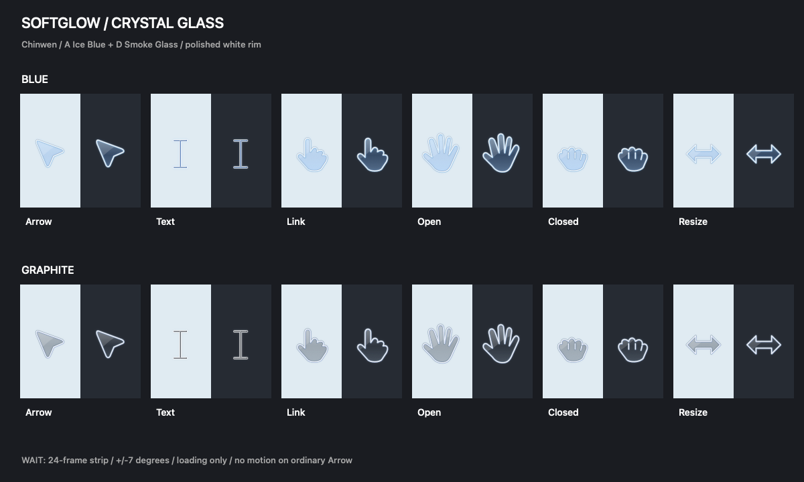
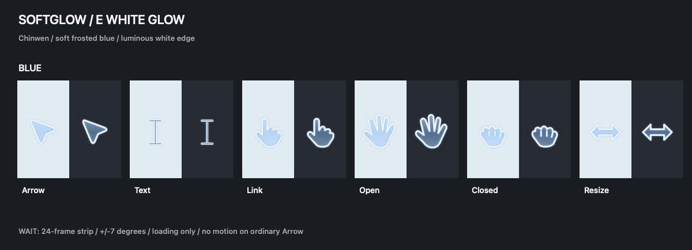

# Softglow Cursors｜macOS 微光鼠标指针

**Chinwen 制作的免费 MaCursor 主题。v0.4 材质预览版。**

Soft-glow mouse cursor themes for macOS / MaCursor, by Chinwen.

三套可选：**A 清透冰蓝、D 烟灰玻璃、E 白边微光**。箭头、手形、文字选择、缩放与等待动画采用一致的材质语言。

## 外观预览

以下为实际主题渲染，不是 AI 概念图。上排 A、下排 D，每项展示深浅背景效果；概览只展示主要造型，未逐一列出所有旋转和兼容别名。

E 使用更柔和的雾面淡蓝与更醒目的白色发光边缘。

### 等待动画

普通指针静止，只有应用请求等待状态时轻微摇摆，不代表网页或 AI 的真实运行进度。

## 下载

- [A 清透冰蓝 · Ice Blue](https://github.com/Chinwen199/softglow-cursors/releases/download/v0.4.0-preview.1/Softglow-A-Ice-Blue-v0.4.cursor)
- [D 烟灰玻璃 · Smoke Glass](https://github.com/Chinwen199/softglow-cursors/releases/download/v0.4.0-preview.1/Softglow-D-Smoke-Glass-v0.4.cursor)
- [E 白边微光 · White Glow](https://github.com/Chinwen199/softglow-cursors/releases/download/v0.4.0-preview.1/Softglow-E-White-Glow-v0.4.cursor)
- [完整源码 ZIP](https://github.com/Chinwen199/softglow-cursors/releases/download/v0.4.0-preview.1/softglow-cursors-v0.4-source.zip)
- [版本说明与历史版本](https://github.com/Chinwen199/softglow-cursors/releases)

## 安装与恢复

1. 安装 [MaCursor](https://github.com/writronic/MaCursor)。
2. 下载上方所选配色的 `.cursor` 文件。
3. 在 MaCursor 的「文件 → 导入主题」中导入，选中后点击「应用」。工具栏加号是新建空主题，不是导入。
4. 恢复时选择原主题，或点击「恢复系统指针」。

大小可在 MaCursor 指针控制设置中调整。若主题切换窗口后失效，先检查 macOS「无障碍 → 显示 → 指针」中的自定义颜色是否为默认值。

## v0.4 更新

- 新增 A、D、E 三套材质，覆盖现有手形、文字选择、各方向缩放与等待动画。
- 将浏览器具名标识显式加入主题：每套 **53 个底层标识，MaCursor 默认显示 51 项**。其中很多是同一图片的兼容别名，不是 51 种独立造型；部分在编辑器中显示 `Unknown`。
- 前一版兼容映射已由作者在本机 Chrome 的手形与拖窗场景中确认改善；新材质沿用该映射，跨应用与长时间使用仍需实测。
- 作者对外署名统一为 **Chinwen**。

## 已知限制

- 这是设计预览版，尚非完整系统指针包。复制、禁止、帮助、移动、准星等未专门设计的状态可能回退为系统默认。
- 玻璃感由半透明渐变、反光与白边绘制，不会实时折射或模糊背后的窗口。
- 深浅背景表现、热点点击精度、不同系统版本和应用兼容性仍需继续实测；不能保证所有场景都被接管。
- MaCursor 无法替换应用自行绘制的指针；系统安全界面也可能强制使用默认样式。
- 已完成图片解码、透明通道、热点边界、动画尺寸、别名一致性和对角方向检查；这些检查不等于完整使用测试。

## 源码与许可

当前通过浏览器维护发布快照；源码 ZIP 包含 `scripts/`、`Glass-v04/`、`Whiteglow-E/`，含可编辑 SVG、PNG、动画、主题及生成校验脚本。以 Swift 渲染脚本和最终 PNG 为运行效果基准。

作者：**Chinwen**，使用 AI 辅助设计与编码。视觉灵感来自轻盈微光指针，不是 OpenAI 官方项目，也不含从 OpenAI 安装包提取的图片。

- 原创图形：[CC BY 4.0](https://creativecommons.org/licenses/by/4.0/)，署名 `Softglow Cursors by Chinwen and contributors`，修改后请说明变化。
- 生成脚本：MIT。见 [LICENSE-CODE](LICENSE-CODE) 与 [LICENSE-ARTWORK.md](LICENSE-ARTWORK.md)。
- 早期历史版本中的 Jingwen 指同一作者，对外署名使用 Chinwen。

欢迎在 [Issues](https://github.com/Chinwen199/softglow-cursors/issues) 提交截图、应用名称、系统和 MaCursor 版本。
