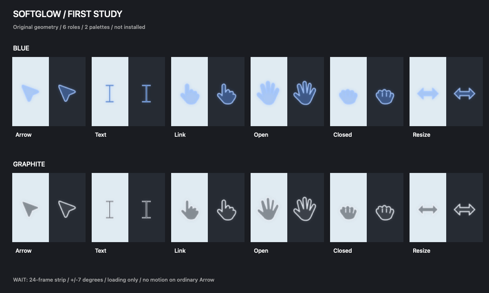

# Softglow Cursors｜macOS 微光鼠标指针

**蓝色与烟灰色 · 免费 MaCursor 主题 · by Chinwen**

轻柔、半透明、带微光的 Mac 鼠标指针，包含静态造型与等待动画。Soft-glow mouse cursor themes for macOS / MaCursor.

**v0.3 设计预览版，尚非完整指针包。**

[下载与版本说明](https://github.com/Chinwen199/softglow-cursors/releases/tag/v0.3.0-preview.1)

## 外观预览

上排为淡蓝色，下排为烟灰色；每种造型同时展示深浅背景效果。图片为初期风格样张，不是全部状态清单。

## 下载

- [下载淡蓝色 Blue](https://github.com/Chinwen199/softglow-cursors/releases/download/v0.3.0-preview.1/Softglow-blue-trial01.cursor)
- [下载烟灰色 Graphite](https://github.com/Chinwen199/softglow-cursors/releases/download/v0.3.0-preview.1/Softglow-graphite-trial01.cursor)
- [完整源文件 ZIP](https://github.com/Chinwen199/softglow-cursors/releases/download/v0.3.0-preview.1/softglow-cursors-v0.3-source.zip)：包含 Swift 生成与校验脚本、SVG、透明 PNG、多分辨率图片、动画条带和主题文件。

目前为通过浏览器上传的公开预览快照，完整源码目录结构保存在 ZIP 内。

## 安装与恢复

1. 安装 [MaCursor](https://github.com/writronic/MaCursor)。
2. 下载上方所需颜色的 `.cursor` 文件。
3. 在 MaCursor 点击「添加主题」导入，选中后点击「应用」。
4. 如需回退，点击「恢复系统指针」。

若切换窗口后主题被覆盖，将系统自定义指针颜色重设为默认，再重新应用。大小可在「系统设置 → 无障碍 → 显示 → 指针」中调整。

## 等待动画

普通状态静止；仅应用请求等待状态时播放轻微摇摆动画，不代表网页或 AI 的真实运行进度。

## 当前包含

箭头、文字选择、链接手形、张手、握手，横向、纵向、两个对角方向缩放，以及等待与忙碌动画。29 个底层标识在 MaCursor 中显示 27 个条目，不等于 27 种独立造型。

## 已知限制

- 复制、别名、移动、禁止、帮助、准星等仍未完成，参见[覆盖清单](COVERAGE.md)。未实现状态使用系统默认，不混用第三方主题。
- 同轴边缘共用双向缩放图形。
- 浅背景蓝色清晰度、手形比例、小目标点击准确性需要继续实测。
- 已在作者的一台 Mac 上通过 MaCursor 加载试用，尚无跨设备兼容保证。
- 文件校验通过：图片解码、透明通道、热点边界、动画条带尺寸和两个对角方向的图像区别。但边界合法不等于点击精度已充分验证。
- 应用自行绘制的指针可能不受系统主题影响。

## 作者与许可

**Chinwen** 发起并指导，使用 AI 辅助设计与编码。不是 OpenAI 官方项目，不含从 OpenAI 安装包提取的图片，也不包含早期已移除的混合主题试验品。

- 原创图形：[CC BY 4.0](https://creativecommons.org/licenses/by/4.0/)，署名「Softglow Cursors by Chinwen and contributors」，修改时注明变化。见 [LICENSE-ARTWORK.md](LICENSE-ARTWORK.md)。
- 脚本：MIT，见 [LICENSE-CODE](LICENSE-CODE)。
- 早期下载包与许可文件中的 Jingwen 指同一作者；对外署名请使用 **Chinwen**。
- 更多来源说明：[ATTRIBUTION.md](ATTRIBUTION.md)。

## 反馈

欢迎在 [Issues](https://github.com/Chinwen199/softglow-cursors/issues) 提交建议。反馈兼容问题时，请附 macOS / MaCursor 版本、应用名称和截图。
